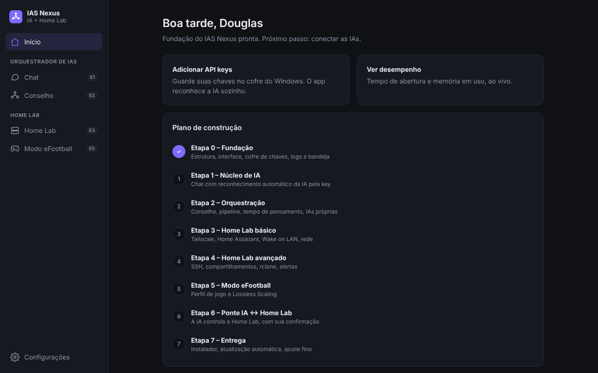
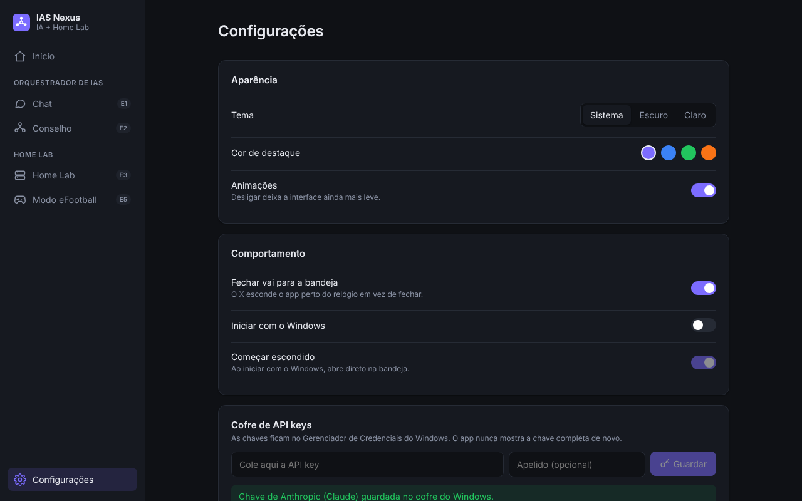

# IAS Nexus — Etapa 0: Fundação

Um único app para Windows com dois módulos: **Orquestrador de IAs** e **Home Lab**.
Esta etapa constrói a base sobre a qual todo o resto vai rodar. Ainda não conversa com IAs (isso é a Etapa 1), mas já abre, tem interface completa, guarda as suas API keys com segurança, salva configurações, registra logs, fica na bandeja e mede o próprio desempenho.



---

## 1. Por que essas tecnologias

| Parte | Tecnologia | Por quê |
|---|---|---|
| Motor do app | **Rust + Tauri 2** | Usa o navegador que já vem no Windows (WebView2) em vez de embutir um Chrome inteiro como o Electron. O .exe fica com ~10 MB em vez de ~150 MB, abre mais rápido e gasta bem menos RAM. Resolve direto as queixas do IAS antigo: demorava a abrir, travava e pesava. |
| Interface | **React + TypeScript** | Interface moderna, com tipos checados: erro de digitação no código vira erro de compilação, não bug na sua tela. |
| Dados | **SQLite** (arquivo `nexus.db`) | Banco de dados num único arquivo, sem servidor. Vai guardar histórico de chat, dispositivos do Home Lab etc. |
| API keys | **Gerenciador de Credenciais do Windows** | Mesmo cofre que o Windows usa para senhas. As chaves ficam criptografadas pela sua conta, nunca em texto puro num arquivo. |

---

## 2. O que já funciona

**Janela sem tela branca.** A janela nasce invisível, a interface desenha a primeira tela e só então ela aparece. O tema é aplicado antes do primeiro desenho, então não pisca cor errada.

**Interface limpa e moderna.** Barra lateral com as áreas do app já reservadas (Chat, Conselho, Home Lab, Modo eFootball), cada uma mostrando em qual etapa chega. Tema claro, escuro ou automático (segue o Windows ao vivo), 4 cores de destaque e opção de desligar animações.

**Cofre de API keys.** Você cola a chave e o app reconhece o provedor na hora pelo formato:

| Começa com | Provedor |
|---|---|
| `sk-ant-` | Anthropic (Claude) |
| `sk-proj-` ou `sk-` | OpenAI (ChatGPT) |
| `AIza` | Google (Gemini) |
| `xai-` | xAI (Grok) |
| `sk-or-` | OpenRouter |
| `gsk_` | Groq |
| `pplx-` | Perplexity |

Depois de guardada, a interface só vê uma dica como `sk-a…9xYz`. A chave completa só é lida pelo backend, na hora de chamar a IA. (DeepSeek também usa `sk-`; na Etapa 1 o app desempata testando a chave na API.)

**Bandeja do sistema.** Fechar no X esconde o app perto do relógio (desligável). Clique no ícone para voltar; botão direito → Sair para fechar de verdade.

**Instância única.** Abrir o app de novo só traz a janela que já existe para frente, em vez de abrir uma segunda cópia gastando memória.

**Iniciar com o Windows**, com opção de já começar escondido na bandeja.

**Diagnóstico ao vivo** (Configurações → Diagnóstico): tempo de abertura, memória somada do app + janela, processos, versão, pastas. Mostra se está dentro das metas:
- abrir em **menos de 1,5 s**
- usar **menos de 150 MB** parado

**Logs.** Um arquivo por dia, guardando os últimos 7. Erros da interface também vão para o log. A gravação é em segundo plano, então logar nunca deixa o app lento.

**Proteção contra travamento.** Se uma tela der erro, só ela mostra o aviso com "Tentar de novo". O resto do app continua funcionando, e o erro fica registrado.



---

## 3. Como o código está organizado

```
ias-nexus/
├─ src/                      ← INTERFACE (React)
│  ├─ main.tsx               inicialização: tema → desenho → mostra janela
│  ├─ App.tsx                barra lateral e navegação
│  ├─ styles.css             todo o visual (temas por variáveis CSS)
│  ├─ lib/api.ts             ponte tipada com o backend (único ponto de contato)
│  ├─ lib/theme.ts           aplica tema/cor/animações
│  ├─ components/            ícones, proteção contra erros
│  └─ pages/                 Início, Configurações, telas "em breve"
│
├─ src-tauri/                ← MOTOR (Rust)
│  ├─ src/lib.rs             liga tudo: plugins, pastas, banco, bandeja
│  ├─ src/commands.rs        funções que a interface pode chamar
│  ├─ src/db.rs              SQLite + migrações versionadas
│  ├─ src/settings.rs        configurações com valores padrão
│  ├─ src/vault.rs           cofre de API keys + reconhecimento do provedor
│  ├─ src/diagnostics.rs     medição de memória e sistema
│  ├─ src/logging.rs         logs diários
│  ├─ src/tray.rs            ícone na bandeja
│  ├─ tauri.conf.json        janela, segurança, instalador
│  └─ Cargo.toml             dependências + otimizações de release
│
└─ .github/workflows/        compila o .exe automaticamente no GitHub
```

**Como a interface fala com o motor:** a interface chama, por exemplo, `api.vaultAdd(chave, apelido)`. Isso vira uma chamada ao comando `vault_add` em Rust, que valida, guarda no cofre do Windows e devolve só os metadados. Todo erro volta como uma frase em português, nunca como travamento.

**Preparado para crescer:**
- O banco tem **migrações versionadas**. Cada etapa só adiciona uma migração nova no fim da lista, e o banco de quem já usa o app é atualizado sozinho.
- As configurações aceitam **campos novos** sem quebrar as antigas.
- As telas são **carregadas sob demanda**: o app abre só com o necessário, por maior que fique.

---

## 4. Segurança

- A interface tem permissão mínima (`core:default`) e uma política de conteúdo (CSP) que bloqueia scripts externos.
- API keys nunca são gravadas em arquivo, nunca aparecem em log e nunca voltam completas para a interface.
- Se gravar no cofre der certo mas o índice falhar, a chave é apagada do cofre para não deixar sobras.

---

## 5. Testes

11 testes automáticos no backend, todos passando:
- banco: cria, migra, reabre o arquivo sem perder dados, índice do cofre
- configurações: padrão, salvar/carregar, campo novo, tema inválido rejeitado, arquivo corrompido não impede o app de abrir
- cofre: reconhecimento de todos os provedores, máscara não vaza a chave
- diagnóstico: mede a própria memória

Rodar: `cd src-tauri` e depois `cargo test`.

---

## 6. Como gerar o .exe

### Opção A — No seu PC (Windows 11)

1. Instale uma vez:
   - **Node.js 22 LTS**: https://nodejs.org
   - **Rust**: https://rustup.rs (aceite a instalação do *Visual Studio C++ Build Tools* quando pedir)
2. No PowerShell, dentro da pasta do projeto:
   ```powershell
   npm install
   npm run app:dev      # abre o app em modo desenvolvimento (recarrega ao editar)
   npm run app:build    # gera o .exe final
   ```
3. O resultado fica em:
   - **Instalador:** `src-tauri\target\release\bundle\nsis\IAS Nexus_0.1.0_x64-setup.exe`
   - **.exe direto:** `src-tauri\target\release\ias-nexus.exe`

A primeira compilação leva de 5 a 10 minutos (baixa e compila as dependências). As seguintes levam segundos.

### Opção B — Pelo GitHub, sem instalar nada

1. Crie um repositório e envie esta pasta.
2. Abra a aba **Actions** e rode **Build Windows** (ou só faça um push na `main`).
3. Em ~10 min, baixe o instalador em **Artifacts → IAS-Nexus-windows**.

---

## 7. Onde ficam seus dados

| O quê | Onde |
|---|---|
| Banco e configurações | `%APPDATA%\com.douglas.iasnexus\nexus.db` |
| Logs | `%LOCALAPPDATA%\com.douglas.iasnexus\logs\` |
| API keys | Painel de Controle → Gerenciador de Credenciais → Credenciais do Windows → entradas "IAS Nexus" |

Os botões "Abrir pasta de dados" e "Abrir logs" no Diagnóstico levam direto a essas pastas.

Para logs mais detalhados ao investigar algum problema, abra o app com a variável `IAS_LOG=debug`.

---

## 8. Próxima: Etapa 1 — Núcleo de IA

- Conectar às APIs de Anthropic, OpenAI, Google, xAI e OpenRouter usando as chaves do cofre
- Teste automático da chave ao guardar (válida/inválida, e desempate do DeepSeek)
- Tela de Chat com resposta em tempo real (streaming), rodando fora da thread da interface para nunca travar
- Histórico salvo no SQLite, com busca
